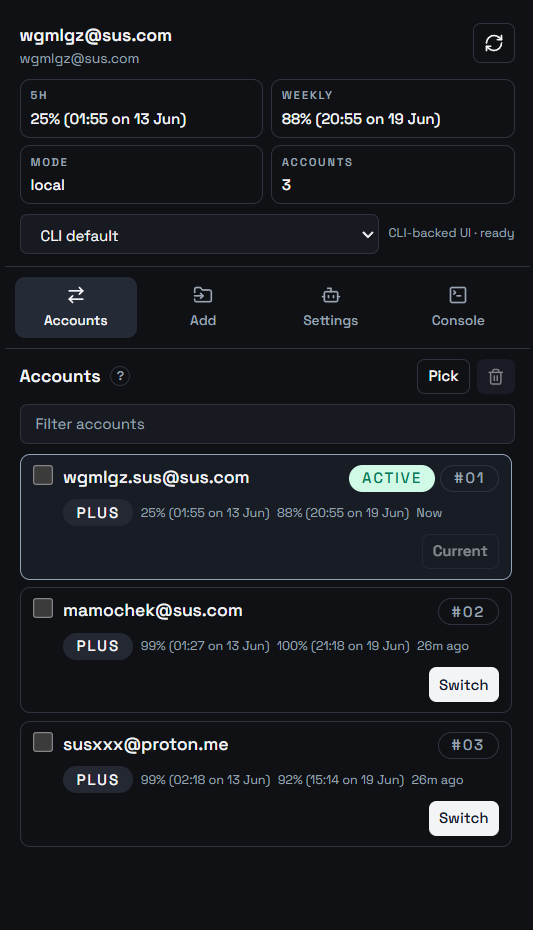

# Codex Auth GUI

## !!! Fully AI-Generated in 5 prompts !!!

Compact Tauri desktop wrapper for [`codex-auth`](https://github.com/Loongphy/codex-auth).

The app does not manage auth files itself. It shells out to the installed `codex-auth` CLI for reads and writes, then presents the results in a small utility-style interface built with Tauri, React, TypeScript, and shadcn-style components.

## Screenshots



## What It Covers

- Account inventory via `codex-auth list`
- Status and usage mode via `codex-auth status`
- Account switching via `codex-auth switch <query>`
- Account switching with a full Codex GUI stop and relaunch
- Codex GUI stop and launch controls (Windows, macOS, and Linux desktop)
- Browser login and device auth login via `codex-auth login`
- File, CPA, and purge imports via `codex-auth import ...`
- Removal flows via `codex-auth remove ...`
- Auto-switch toggles and thresholds via `codex-auth config auto ...`
- API/local usage mode via `codex-auth config api ...`
- Cleanup via `codex-auth clean`
- Raw command console for direct CLI access

## Stack

- Tauri 2
- React 19
- TypeScript
- Vite
- Tailwind CSS 4
- shadcn-style local UI primitives
- TanStack Query

## Requirements

- Node.js 22+
- Rust stable toolchain
- `codex-auth` installed and working on `PATH`

Install the CLI if needed:

```powershell
npm install -g @loongphy/codex-auth
```

Quick sanity check:

```powershell
codex-auth --help
codex-auth status
```

## Development

Install dependencies:

```powershell
npm install
```

Run the desktop app:

```powershell
npm run tauri:dev
```

Build the frontend only:

```powershell
npm run build
```

Lint:

```powershell
npm run lint
```

Create a desktop build:

```powershell
npm run tauri:build
```

## Notes

- The app is intended to be launched through Tauri. Running only the Vite dev server will render the UI, but Tauri command invocations will not be available there.
- The UI is compact on purpose and designed for a small utility window.
- The current page is hash-addressable for quick local previews:

```text
#accounts
#add
#settings
#console
```

## Project Layout

```text
src/          React UI
src-tauri/    Tauri + Rust command bridge
screenshots/  README images
```

## How It Works

The Rust layer in `src-tauri` discovers the installed `codex-auth` command and runs it as the source of truth.

- Dashboard reads come from parsed CLI output
- Mutations are executed through the CLI itself
- The GUI never edits Codex auth/account data directly

That keeps the wrapper thin, safer, and aligned with the behavior of the real CLI version installed on the machine.
